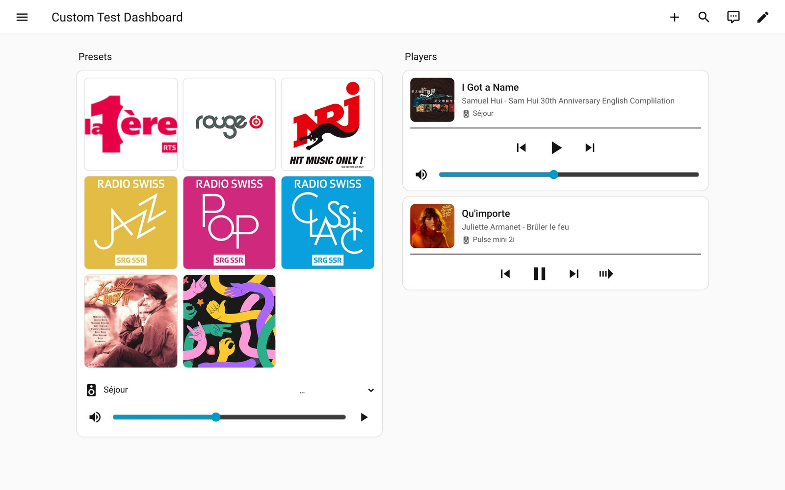

# Dashboard cards

The integration adds two cards to the card picker of your dashboards, with no resource to register:
**BluOS Companion presets** and **BluOS Companion player**. Both follow one BluOS Companion player
(the `media_player` entity of that player) and have a visual editor.



## Presets card

The presets of a player as a grid of artworks, like a wall of radio stations. Tap one to start it.

- The preset that is **playing** has a coloured outline.
- A preset that loads a saved playlist and has no image of its own shows the **cover of that playlist**.
- Under the grid: the name of the player, an **input select** (Bluetooth, TV... only what the player
  offers; a streamer has no amplifier inputs), mute, a volume slider and play / pause.
- A player without presets shows a short message.

```yaml
type: custom:bluos-companion-presets-card
entity: media_player.living_room
columns: 3          # 1 to 8, default 3
show_footer: true   # false hides the name, input, volume and play button
```

## Player card

What a player plays, in a compact card: cover, title, artist and album, previous / play-pause / next, a
thin progress bar and the volume.

- A **move playback** button appears while the player is playing and another player exists: it lists the
  other players, and the music continues there at once.
- An **Open control panel** link to the web page of the player, in a new tab, if you turn it on (off by
  default). The device page of Home Assistant only says "Visit" for the same link and cannot be changed.
- A card whose entity is not a BluOS Companion player says so ("Player not found").

```yaml
type: custom:bluos-companion-player-card
entity: media_player.living_room
show_volume: true          # false hides the mute button and the volume slider
show_control_panel: false  # true shows the "Open control panel" link
```

## Good to know

- The texts follow the language of the Home Assistant user (English, French and German). The names in the
  card picker stay in English: Home Assistant cannot translate custom card names.
- The **maximum volume** of a player (see [Configuration](configuration.md)) limits the sliders of the cards too.
- Cards are loaded by the integration. After an update, reload the page (a tablet in kiosk mode: reload or
  clear its cache) to get the new version of a card.
- You do not need the cards to use the sidebar player, and the other way round.
