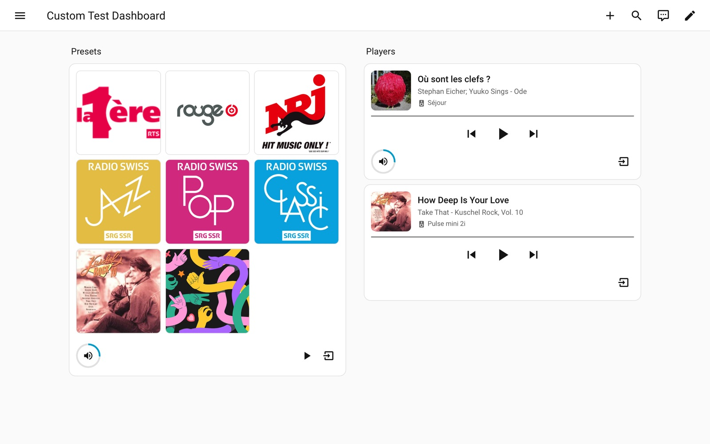

# Dashboard cards

The integration adds three cards to the card picker of your dashboards, with no resource to register:
**BluOS Companion presets**, **BluOS Companion player** and **BluOS Companion play button**. They all follow one
BluOS Companion player (the `media_player` entity of that player) and have a visual editor.



## Presets card

The presets of a player as a grid of artworks, like a wall of radio stations. Tap one to start it.

- The preset that is **playing** has a coloured outline.
- A preset that loads a saved playlist and has no image of its own shows the **cover of that playlist**.
- Under the grid, **one row of buttons**: the **volume** as a ring on the left (tap it and the row turns into a
  slider with mute, **−** and **+**, then comes back after a few seconds), and on the right play / pause, an
  **input** button (a popup with Bluetooth, TV... only what the player offers; a streamer has no amplifier inputs)
  and, if you turn it on, a **power button**.
- The power button is for the amplifier a player is built into (off by default): it is highlighted while the
  amplifier is on and waits for the amplifier to answer (a few seconds when switching on). It only shows for a
  player that has an *Amplifier power* switch, see [Configuration](configuration.md).
- A player without presets shows a short message.

```yaml
type: custom:bluos-companion-presets-card
entity: media_player.living_room
columns: 3          # 1 to 8, default 3
show_footer: true   # false hides the whole row of controls
show_volume: true   # the volume ring
show_playback: true # the play / pause button
show_input: true    # the input button
show_power: false   # true shows the power button of the amplifier
```

## Player card

What a player plays, in a compact card: cover, title, artist and album, previous / play-pause / next, a
thin progress bar and, under it, the same row as the presets card: the volume ring on the left, then on the right
the buttons below.

- A **move playback** button appears while the player is playing and another player exists: it lists the
  other players, and the music continues there at once. You can turn it off.
- An **input** button (a popup) and a **power button** for the amplifier a player is built into (off by default):
  same behaviour as in the presets card.
- An **Open control panel** link to the web page of the player, in a new tab, if you turn it on (off by
  default). The device page of Home Assistant only says "Visit" for the same link and cannot be changed.
- A card whose entity is not a BluOS Companion player says so ("Player not found").

```yaml
type: custom:bluos-companion-player-card
entity: media_player.living_room
show_volume: true          # the volume ring
show_input: true           # the input button
show_power: false          # true shows the power button of the amplifier
show_move: true            # the move playback button
show_control_panel: false  # true shows the "Open control panel" link
```

## Driving another entity

When the amplifier is not a BluOS device (for instance a standalone streamer feeding an amplifier that has its own
integration), the volume, the inputs and the power of a card can be those of **another entity** instead of the
BluOS player. Each is optional, set separately, and comes with a picker in the editor ("Control another entity"):

```yaml
type: custom:bluos-companion-presets-card
entity: media_player.node            # the presets and the playback stay with the BluOS player
other_entities:
  volume_entity: media_player.amplifier   # volume ring: volume and mute of that media player
  source_entity: media_player.amplifier   # input button: its source list
  power_entity: switch.amplifier_power    # power button: a media player, a switch or an input boolean
show_power: true
```

The cards use the standard Home Assistant services (`volume_set`, `volume_mute`, `select_source`, `turn_on` and
`turn_off`), so any entity that supports them works. A control whose entity does not offer it (a media player without
volume, without a source list, unavailable) is hidden. The **maximum volume** of the BluOS player does not apply to
another entity, and the volume buttons there move by 2 %.

## Good to know

- The texts follow the language of the Home Assistant user (English, French and German). The names in the
  card picker stay in English: Home Assistant cannot translate custom card names.
- The **maximum volume** of a player (see [Configuration](configuration.md)) limits the volume of the cards too.
- Cards are loaded by the integration. After an update, reload the page (a tablet in kiosk mode: reload or
  clear its cache) to get the new version of a card.
- You do not need the cards to use the sidebar player, and the other way round.

## Play button card

One button that plays **a genre, a preset or a saved playlist** on a player: tap it and it starts. Put several of
them on a dashboard for the things you play every day.

In the visual editor: choose the player, what the button plays (a genre, a preset or a playlist), then pick the
item in a list of everything the player has. The other options are those of a button:

- **Layout**: *tile* (the cover with the name below), *row* (a small cover with the name beside it, one line high)
  or *cover* (the name over the cover). The size is the size you give the card on the dashboard.
- **Show the cover** and **show the name**: turn either off for a plain text button or a plain picture. A
  genre has no cover and shows an icon, so does a playlist or a preset without one; choose the icon yourself with
  **icon**.
- **Name**: a name of your own instead of the one of the item.
- **Shuffle** and **replace the queue** (genre and playlist): the button plays shuffled, and/or empties the queue
  first instead of adding to it. A preset starts as it is.

The button does exactly what the services [`play_genre`, `play_preset` and `play_playlist`](developer-tools.md)
do, so everything it can do an automation can do too.

```yaml
type: custom:bluos-companion-play-button-card
entity: media_player.living_room
mode: genre         # genre, preset (item is its number) or playlist
item: Dance
layout: tile        # tile, row or cover
show_image: true
show_name: true
name: Dance party   # optional
icon: mdi:party-popper   # optional, when there is no cover
shuffle: true       # genre and playlist
clear_queue: true   # genre and playlist: replace the queue
```
