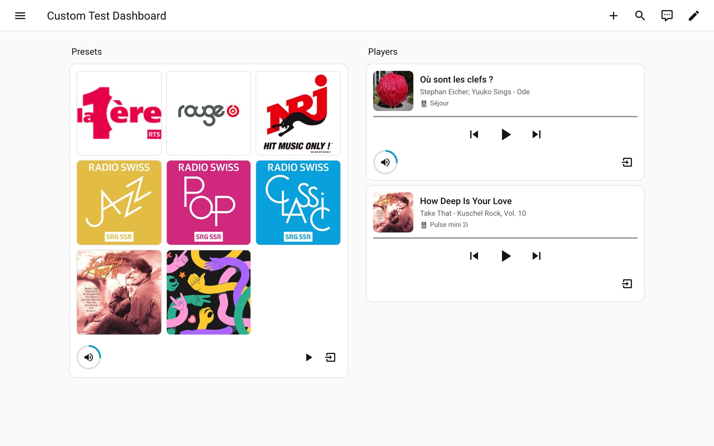

# Dashboard cards

The integration adds three cards to the card picker of your dashboards, with no resource to register:
**BluOS Companion grid** (the presets card), **BluOS Companion player** and **BluOS Companion play button**. They all follow one
BluOS Companion player (the `media_player` entity of that player) and have a visual editor.



## Presets card (grid)

The presets of a player as a grid of artworks, like a wall of radio stations. Tap one to start it. The same grid
can show the **saved playlists** or the **favourite albums** instead, with the `content` option: add the card once
for each grid you want. (The card keeps the type `bluos-companion-presets-card` so that existing dashboards work; the
picker calls it "BluOS Companion grid".)

- `content: presets` (the default): the presets of the player. The one that is **playing** has a coloured outline.
- `content: playlists`: the saved playlists in alphabetical order, with the cover of their first track. A tap plays the
  playlist (the queue is kept and the playlist plays now, as the *Play now* of the panel).
- `content: favourites`: the albums among the favourites of the library, with their cover. A tap plays the album.
  Favourite songs and artists are not shown.
- `max_items` limits the number of tiles. Without it a grid shows all the presets and at most 24 playlists or albums
  (the library may hold hundreds). Playlists and albums are read when the card is loaded or its options change: reload
  the dashboard to see a new favourite.
- `name_on_cover: true` writes the name of each tile **on top of its cover**, at the bottom, whatever the content
  (presets, playlists or favourites). Off by default; a tile without a cover always shows its name.
- A preset that loads a saved playlist and has no image of its own shows the **cover of that playlist**.
- Under the grid, **one row of buttons**: the **volume** as a ring on the left (tap it and the row turns into a
  slider with mute, **−** and **+**, then comes back after a few seconds), and on the right play / pause, an
  **input** button (a popup with Bluetooth, TV... only what the player offers; a streamer has no amplifier inputs)
  and, if you turn it on, a **power button**.
- The power button is for the amplifier a player is built into (off by default): it is highlighted while the
  amplifier is on and waits for the amplifier to answer (a few seconds when switching on). It only shows for a
  player that has an *Amplifier power* switch, see [Configuration](configuration.md).
- A grid without anything to show (no presets, no playlist, no favourite album) says so.

```yaml
type: custom:bluos-companion-presets-card
entity: media_player.living_room
content: presets    # presets (default), playlists or favourites
max_items: 12       # optional, the number of tiles
columns: 3          # 1 to 8, default 3
name_on_cover: false # true writes the name on top of the cover
show_footer: true   # false hides the whole row of controls
show_volume: true   # the volume ring
show_playback: true # the play / pause button
show_input: true    # the input selection
show_power: false   # true shows the power button of the amplifier
```

## Player card

What a player plays, in a compact card: cover, title, artist and album, previous / play-pause / next, a
thin progress bar and, under it, the same row as the presets card: the volume ring on the left, then on the right
the buttons below.

- A **move playback** button appears while the player is playing and another player exists: it lists the
  other players, and the music continues there at once. You can turn it off.
- An **input** button (a popup) and a **power button** for the amplifier a player is built into (off by default):
  same behaviour as in the presets card.
- An **Open control panel** link to the web page of the player, in a new tab, if you turn it on (off by
  default). The device page of Home Assistant only says "Visit" for the same link and cannot be changed.
- A card whose entity is not a BluOS Companion player says so ("Player not found").

```yaml
type: custom:bluos-companion-player-card
entity: media_player.living_room
show_volume: true          # the volume ring
show_input: true           # the input selection
show_power: false          # true shows the power button of the amplifier
show_move: true            # the move playback button
show_control_panel: false  # true shows the "Open control panel" link
```

## Driving another entity

When the amplifier is not a BluOS device (for instance a standalone streamer feeding an amplifier that has its own
integration), the volume, the inputs and the power can be those of **another entity** instead of the BluOS player.
This is set once per player in the options of the integration (see [Configuration](configuration.md)), and the
sidebar player and every card follow it. The cards have nothing to set.

**Cards written before version 4.0.0** carried `other_entities` (`volume_entity`, `source_entity`, `power_entity`) in
their own settings. These are ignored now: the card shows a hint, and the three entities go to the options of the
player instead. Once moved, delete `other_entities` from the card.

## Good to know

- The texts follow the language of the Home Assistant user (English, French and German). The names in the
  card picker stay in English: Home Assistant cannot translate custom card names.
- The **maximum volume** of a player (see [Configuration](configuration.md)) limits the volume of the cards too.
- Cards are loaded by the integration. After an update, reload the page (a tablet in kiosk mode: reload or
  clear its cache) to get the new version of a card.
- You do not need the cards to use the sidebar player, and the other way round.

## Play button card

One button that plays **a genre, a preset or a saved playlist** on a player: tap it and it starts. Put several of
them on a dashboard for the things you play every day.

In the visual editor: choose the player, what the button plays (a genre, a preset or a playlist), then pick the
item in a list of everything the player has. The other options are those of a button:

- **Layout**: *tile* (the cover with the name below), *row* (a small cover with the name beside it, one line high)
  or *cover* (the name over the cover). The size is the size you give the card on the dashboard.
- **Show the cover** and **show the name**: turn either off for a plain text button or a plain picture. A
  genre has no cover and shows an icon, so does a playlist or a preset without one; choose the icon yourself with
  **icon**.
- **Image**: a picture of your own (a URL, or a path such as `/local/jazz.jpg`) instead of the cover. It also
  stands in when there is no cover, and wins over **icon**.
- **Name**: a name of your own instead of the one of the item.
- **Shuffle** and **replace the queue** (genre and playlist): the button plays shuffled, and/or empties the queue
  first instead of adding to it. A preset starts as it is.

The button does exactly what the services [`play_genre`, `play_preset` and `play_playlist`](developer-tools.md)
do, so everything it can do an automation can do too.

```yaml
type: custom:bluos-companion-play-button-card
entity: media_player.living_room
mode: genre         # genre, preset (item is its number) or playlist
item: Dance
layout: tile        # tile, row or cover
show_image: true
show_name: true
name: Dance party   # optional
image: /local/dance.jpg  # optional, replaces the cover
icon: mdi:party-popper   # optional, when there is no cover and no image
shuffle: true       # genre and playlist
clear_queue: true   # genre and playlist: replace the queue
```
