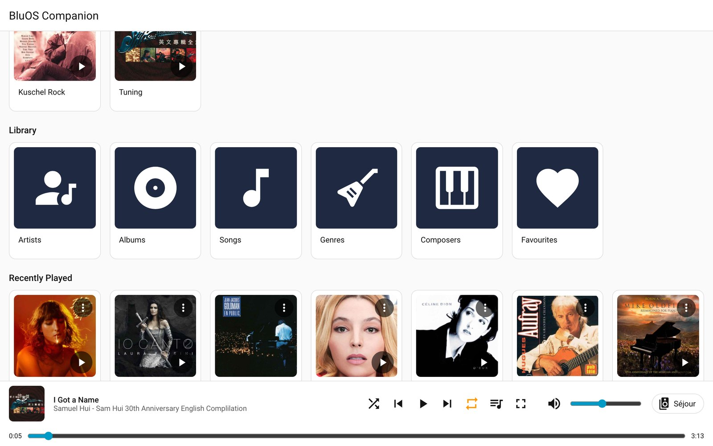
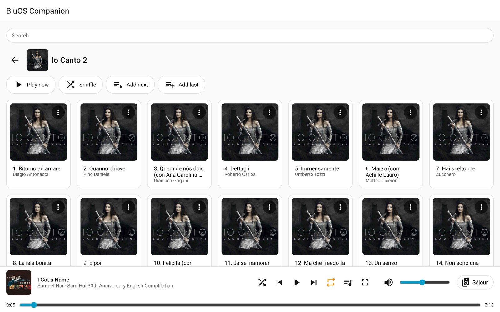
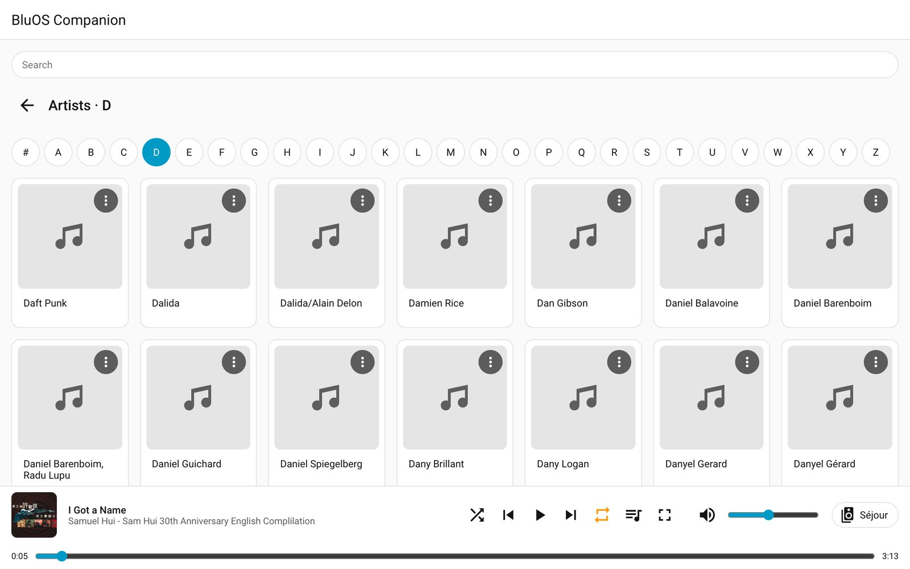
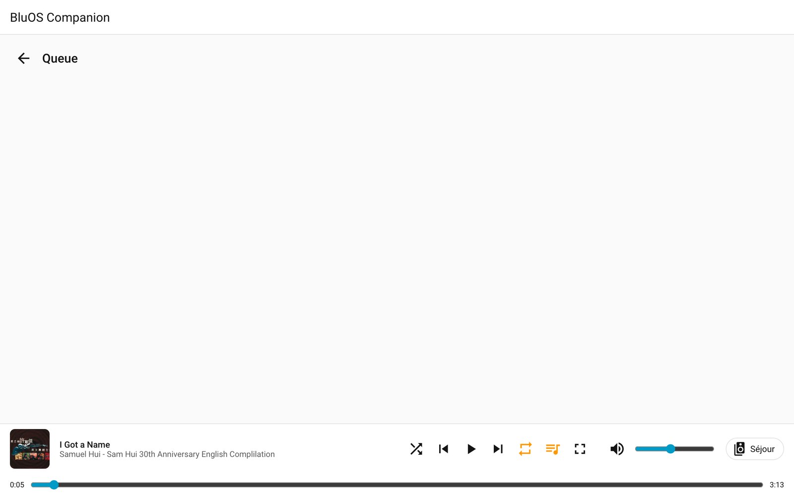
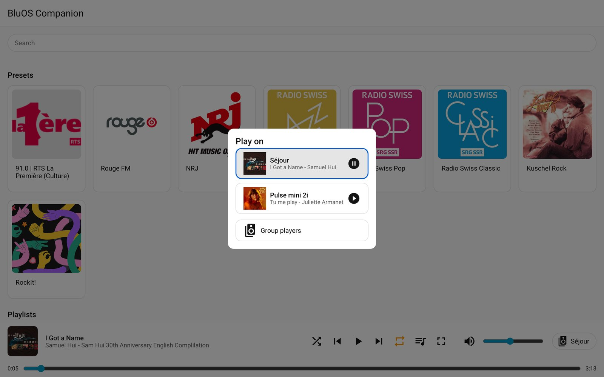
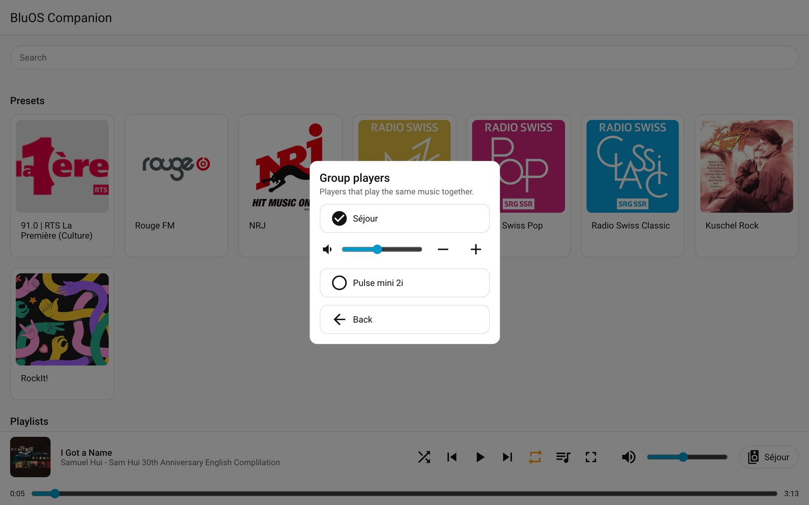
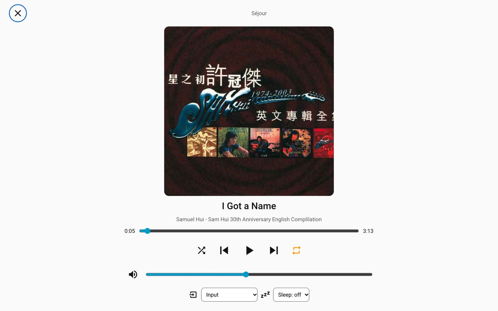

# The sidebar player

**BluOS Companion** appears in the sidebar of Home Assistant for **every user** (it is not limited to
administrators). It is designed for touch screens: a tablet fixed to a wall in kiosk mode can browse
the music and control the players without leaving Home Assistant.

It only shows BluOS Companion players, not the other media players of Home Assistant.

## The bottom bar

Always visible, for the player you chose:

- the cover, the title and the artist. **Tap the title** to go to the album or the artist page of the
  playing track (for tracks of your library)
- previous / play-pause / next, shuffle and repeat, volume and mute
- the **player button**: it shows the player (or the group, "Kitchen + Living room"). It opens the list
  of players, to choose where the music plays and to group players
- a button for the **queue**, a button for the **full-screen view**, and a button to **move the
  playback** to another player (only shown while the player is playing)

## Home page

From top to bottom: your **presets**, your **saved playlists** (with the cover of their first track), the
**library** (Artists, Albums, Songs, Genres...), **recently played**, **recent stations**, **recently added**
albums and your **sources** (services such as TuneIn or Deezer, and inputs such as Bluetooth). The titles
come from the player, in your language. Services you do not use can be hidden, see
[Configuration](configuration.md).

Presets belong to a player: a player without presets has no presets row.

## Browsing

- **Library**: artists, albums, songs and composers come with an **A–Z bar** (`# A B … Z`). Inside a
  letter the bar stays at the top, to jump to another letter. Long lists without letters (genres) get a bar of first
  letters. Very long lists are cut and offer **Show more**.
- **Albums and artists** open on a page with **Play now, Shuffle, Add next, Add last** (the
  actions the player offers). Every tile has a **⋮** menu with the same actions, and a play button on albums.
- **Favourites**: albums, artists and songs of your library also offer **Add to favourites** (or **Remove from
  favourites** when they are one), on their page and in their **⋮** menu. For the **track that is playing**, tap
  its title in the bar: next to *go to the album* and *go to the artist* you find the same action, so there is no
  extra button on the screen. The favourites are the player's own, you
  find them under **Favourites** in the library, in the BluOS app and on every player (they are shared). Removing
  from the *Favourites* list of the BluOS app works as well.
- **Playlists** open to their tracks. Tap a track to play it and carry on with the rest of the playlist.
  Entries the player cannot find anymore (moved files) are not listed.
- **Search** (the field at the top): searches the source you are in, the library from the home page.
  Results are grouped (artists, albums, songs...).
- Tap a track in the bar, in a queue row's ⋮ menu or in a song result's ⋮ menu to jump to its **album page** or
  **artist page**.

## The queue

The queue button opens the tracks of the current queue, the playing one highlighted. Tap a track to
play it; use ⋮ to move it up or down; the cross removes it. **Clear** empties the queue and **Save as
playlist** keeps it under a name.

## Players, groups and moving music

- The **player button** lists the players, with what each one plays and its group. Choosing one makes it
  the target of everything you do in the panel.
- **Group players**: switch players on or off in the group of the current one. Each member has its own
  volume (slider, − and +), and the group has a volume (− and +, in steps that keep the balance) and a
  mute. **Ungroup all** dissolves the group.
- **Move playback** sends what a player is playing (queue and position) to another player, which starts
  it right away while the first pauses. It is only offered for a player that is playing.

## Full-screen view

For a wall tablet: a big cover, the transport buttons, the position and the volume, plus the **input** of the
player (Bluetooth, TV...) and the **sleep timer**.

## Kiosk tips

- Use Home Assistant's kiosk mode of your choice to hide the sidebar and the header, and open
  `/bluos-companion` directly.
- Buttons get larger on touch screens.
- To keep a wall tablet from being turned up too loud, set the **maximum volume** of the player in its options
  (it applies to the panel, the cards and voice control, not to the BluOS app or the remote).
- The panel remembers the last player you chose in each browser.

## Languages

English, French and German, following the language of the Home Assistant user. Menu names (Artists,
Albums...) use the official names the BluOS player gives in your language.
